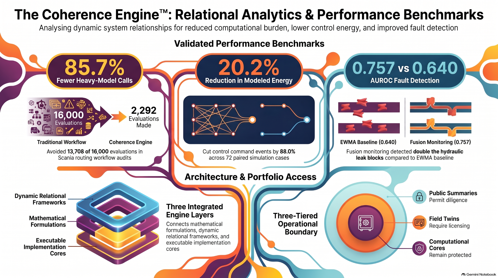

# The Coherence Engine™ Investor Research Atlas

### [Open the live interactive benchmark viewer](https://delta72-investor-research-atlas.allialli05.chatgpt.site/replays.html)

Explore Allison Hensgen’s computational research, benchmark evidence and application concepts.

## Open the live atlas

### [View the interactive research atlas →](https://delta72-investor-research-atlas.allialli05.chatgpt.site/)

The interactive website includes research visuals and pages for NASA C-MAPSS, Scania APS, HBI control simulation, model-family gating, household power, ECG, credit-card fraud and mathematical extensions.

## Investor materials

- [The Coherence Engine overview, 15-page screen-optimized PDF](investor-materials/The_Coherence_Engine.pdf)
- [Relational analytics and performance benchmarks, full-size PNG](investor-materials/Relational_Analytics_and_Performance_Benchmarks.png)

The benchmark graphic is a presentation summary. Results apply to their named datasets, implementations and protocols; see the validation portfolio below for supporting evidence and limitations.

## Explore supporting evidence

- [Public validation portfolio](https://github.com/CoherenceEngine/Research/tree/main/validation), audit tools, result summaries and reproduction requirements.
- [Public research repository](https://github.com/CoherenceEngine/Research), evaluation guidance and preserved negative results.

## How to read the results

The Coherence Engine™ is an implemented, benchmark-tested computational system. Results apply to their named datasets, implementations and protocols. Internal benchmarks, archived reruns, simulations, preliminary applications and mathematical hypotheses have different evidence levels. The validation portfolio identifies the artifacts available for review and the gaps remaining before independent engine replication.

Heavy-model calls avoided are distinct from measured electricity savings. HBI energy results are modeled simulation outcomes. Physiological benchmarks do not establish clinical efficacy. Mathematical and symbolic Δ.72 interpretations are separate from empirical validation.

## About

Created by Allison Hensgen. [Coherence Engine website](https://coherenceengine.org).

This public entry page links to public materials. The private project portfolio and proprietary engine implementation are not included.
